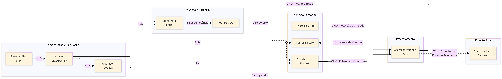
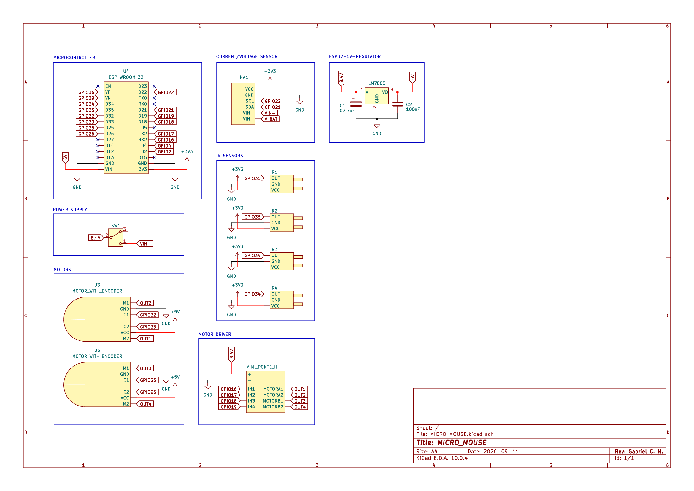

# Projeto conceitual de _hardware_

<figure>

| Diagrama de blocos | Esquemático |
|:------------------:|:-----------:|
|  |  |

<figcaption>

**Figura 1.** Diagrama de blocos e esquemático elétrico do sistema de controle e navegação do micromouse.

</figcaption>

</figure>

## Descrição dos subsistemas e justificativas de projeto

### 1. Microcontrolador
* **Componentes:** Módulo ESP_WROOM_32 (ESP32).
* **Conexões principais:** Recebe alimentação de 5V e distribui sinais lógicos através dos seus pinos GPIO e barramento I2C.
* **Justificativa:** O ESP32 foi selecionado pelo seu elevado poder de processamento, vasta disponibilidade de pinos e suporte a interrupções de *hardware*. Como o objetivo do robô é chegar à célula diagonalmente oposta guiando-se pelas paredes (sem a necessidade de mapear o centro do labirinto com algoritmos complexos como o *flood fill*), a capacidade de processamento do ESP32 é totalmente direcionada para garantir um algoritmo de *wall-following* reativo e de alta velocidade. O processamento rápido, aliado às interrupções, garante leituras precisas dos *encoders* e dos sensores IR em tempo real para manter o alinhamento constante.

### 2. Driver de motor e locomoção
* **Componentes:** *Driver* de ponte H dupla L298N e dois motores DC com *encoders* integrados.
* **Conexões principais:** O ESP32 envia sinais de controle para o L298N, que entrega potência aos motores. Os *encoders* retornam o sinal de odometria para o microcontrolador. O pino de saída de 5V do L298N conecta-se ao pino VIN do ESP32.
* **Justificativa:** O L298N foi escolhido por ser uma solução confiável para o controle bidirecional de motores DC, mas o **fator decisivo para esta escolha foi a inclusão de um regulador de tensão de 5V integrado na placa**. Isso permite utilizar a própria ponte H para alimentar diretamente o microcontrolador ESP32 através do pino VIN, simplificando drasticamente o esquemático e eliminando a necessidade de adicionar módulos conversores *step-down* externos. Em conjunto com os motores com *encoders*, garante o controle PID rigoroso necessário para que o robô faça retas perfeitas e rotações precisas sem colidir com as paredes.

### 3. Sensores IR (sistema de percepção)
* **Componentes:** Três módulos de sensores infravermelhos.
* **Conexões principais:** Alimentados com 3.3V, possuem suas saídas de sinal conectadas diretamente aos pinos de leitura analógica/digital do ESP32.
* **Justificativa:** Três sensores são o requisito mínimo viável para a navegação eficiente no labirinto, dispostos apontando para a frente, esquerda e direita. Eles detectam a presença e a distância das paredes, permitindo o alinhamento dinâmico do robô (*wall-following*) e a tomada de decisão em cruzamentos para alcançar a quina oposta.

### 4. Sensor de corrente e tensão (gerenciamento de energia)
* **Componentes:** Módulo INA219.
* **Conexões principais:** Comunica-se com o ESP32 exclusivamente via protocolo I2C. Conectado aos terminais da bateria para leitura da linha principal.
* **Justificativa:** Implementar o INA219 permite ao robô monitorar ativamente o seu próprio consumo elétrico e a tensão da bateria. Isso é crucial para evitar descargas profundas que poderiam danificar baterias LiPo e para garantir que o desempenho dos motores (que cai conforme a tensão diminui) possa ser compensado via *software*.

### 5. Motores DC com *encoders* (atuação e odometria)
* **Componentes:** Motores DC com caixa de redução e *encoders* de quadratura integrados (canais A e B).
* **Conexões principais:** Os terminais de potência dos motores são conectados diretamente às saídas do *driver* L298N. Os pinos de sinal dos *encoders* são conectados aos pinos GPIO do ESP32 configurados com interrupção, compartilhando também a alimentação lógica (VCC e GND).
* **Justificativa:** A utilização de motores com *encoders* integrados é vital para o controle de malha fechada do micromouse. Operar em malha aberta (apenas enviando PWM para os motores) resultaria em trajetórias tortas devido a diferenças de atrito no chão, desgastes na caixa de redução e flutuações na tensão da bateria. Os *encoders* fornecem o *feedback* exato de deslocamento e velocidade de cada roda (odometria), alimentando o algoritmo de controle PID no ESP32. Isso garante que o robô faça retas perfeitas e giros exatos de 90° ou 180°. Além disso, a leitura precisa do deslocamento permite que o sistema conte exatamente quantas células do labirinto foram atravessadas. Essa contagem de células é fundamental para rastrear a posição do robô no *grid* e identificar o momento exato em que ele atinge a célula de destino (a quina diagonalmente oposta), determinando a condição de parada.

### 6. Chave liga/desliga e capacitores de filtro (estabilidade e segurança)
* **Componentes:** Chave interruptora mecânica (*switch*) e capacitores de desacoplamento (eletrolíticos de 100µF/10µF e cerâmicos de 100nF).
* **Conexões principais:** A chave (*switch*) está conectada em série entre o terminal VIN- do INA219, que está recebendo a tensão da bateria para o monitoramento da mesma, e a entrada principal de energia do circuito. Os capacitores estão conectados em paralelo entre as linhas de alimentação (5V e 3.3V) e o terra (GND), posicionados estrategicamente próximos aos pinos de entrada do *driver* L298N e do microcontrolador ESP32.
* **Justificativa:** A chave mecânica é uma implementação de segurança e usabilidade, permitindo ligar e desligar o robô rapidamente sem a necessidade de conectar e desconectar os cabos da bateria repetidas vezes, o que previne desgastes dos terminais e possíveis curtos-circuitos acidentais. Os capacitores, por sua vez, são obrigatórios para a estabilidade do circuito (*bypass* e desacoplamento). O acionamento e a mudança de direção dos motores DC geram picos altos de corrente e ruído elétrico severo. Os capacitores eletrolíticos atuam como "reservatórios" locais de energia, compensando quedas bruscas de tensão quando os motores partem. Já os capacitores cerâmicos de 100nF filtram os ruídos de alta frequência gerados pelas escovas dos motores. Sem essa filtragem, o ruído elétrico invadiria a linha lógica do ESP32, causando *resets* inesperados e travamentos no algoritmo durante o percurso no labirinto.
