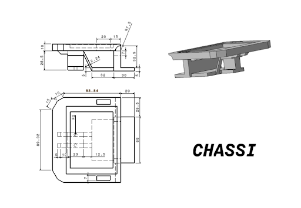
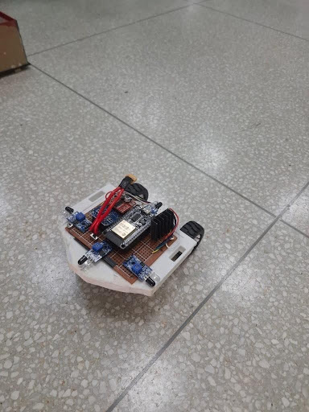
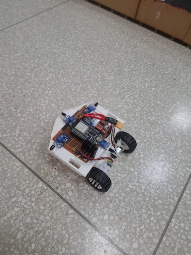
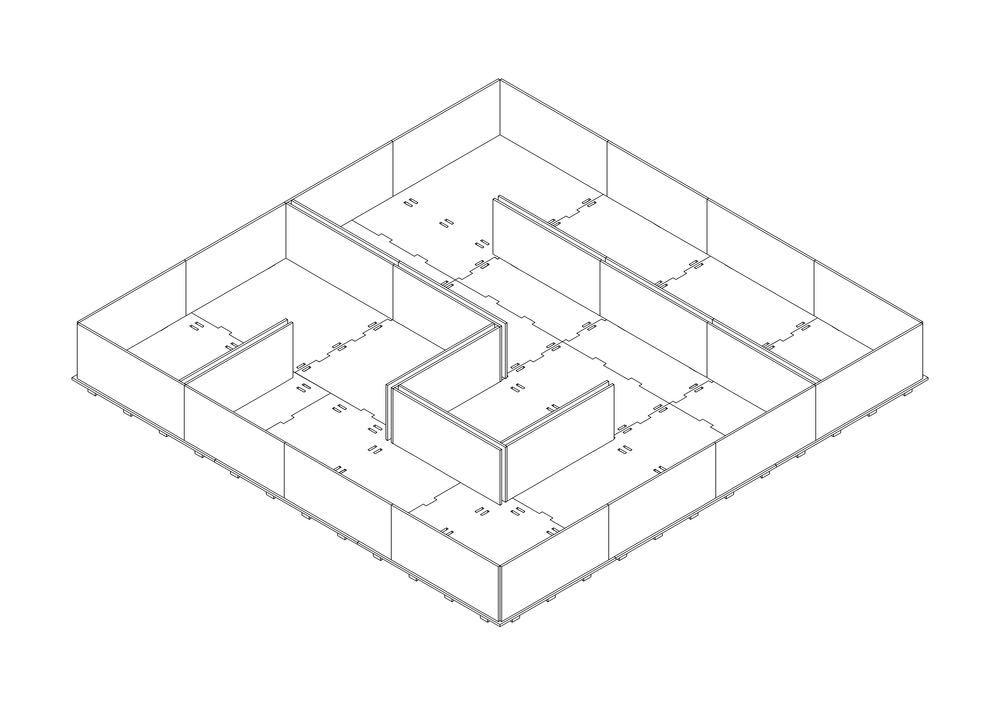
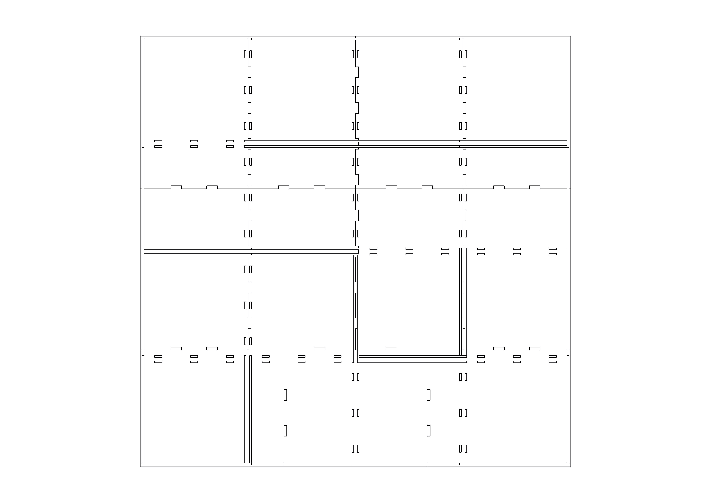
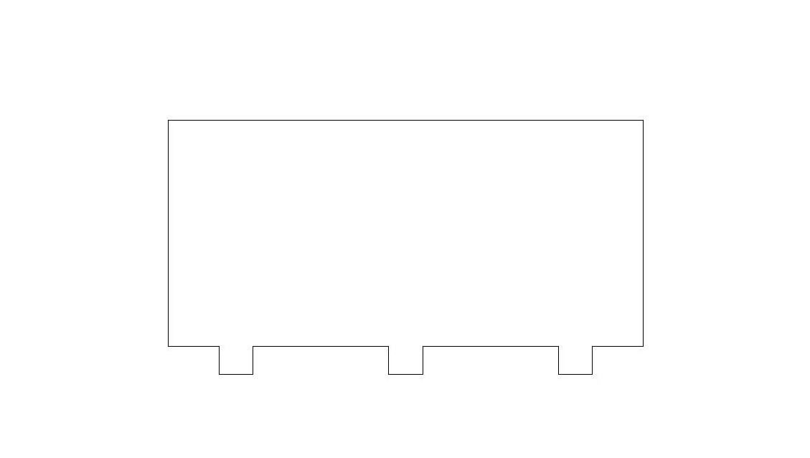
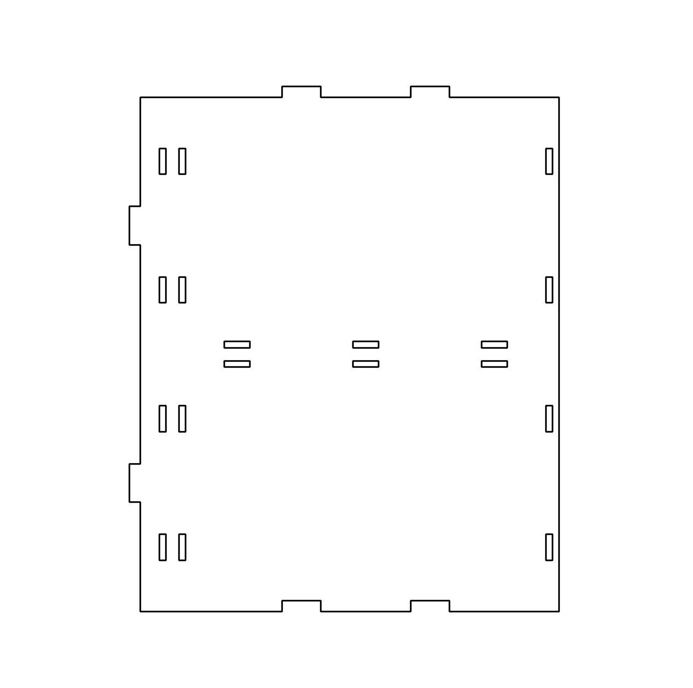
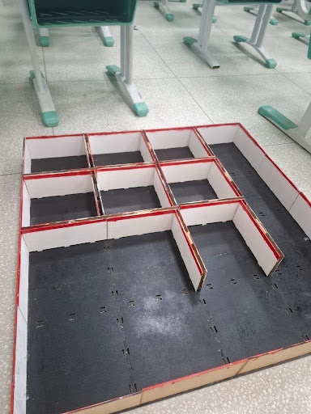
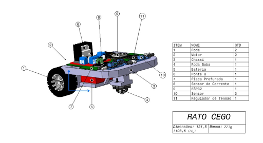

# Testes de Estrutura

## 1.1 Projeto mecânico do chassi

O chassi do Rato Cego é uma peça única impressa em 3D que reúne, em um só corpo, a placa de fixação da eletrônica, o suporte dos motores, o compartimento da bateria e o apoio da roda boba. Essa integração elimina suportes intermediários desnecessários, reduz o número de peças e facilita a montagem e a manutenção do robô. O projeto priorizou três aspectos: manter o robô compacto o suficiente para circular com folga nos corredores do labirinto, concentrar a massa próxima ao piso e distribuir os apoios de forma equilibrada.

A placa superior recebe a placa perfurada com o ESP32, a ponte H, o sensor de corrente e o regulador de tensão. Os cantos traseiros são chanfrados, o que reduz o risco de a traseira enroscar nas paredes durante as curvas. Na parte dianteira, um prolongamento mais baixo da placa serve de apoio para a roda boba, com transição arredondada para a placa superior. Na parte traseira, sob a placa, uma estrutura com paredes de 5 mm de espessura forma o compartimento da bateria e os apoios laterais dos motores, ligada à placa por um reforço inclinado que aumenta a rigidez do conjunto.

Para esta entrega de testes de estrutura, o chassi passou por modificações geométricas importantes: a medida vertical foi aumentada para cima, ampliando a altura do compartimento inferior para acomodar melhor a bateria e os motores com folga sob a placa principal. Além disso, os furos nas laterais da placa superior tiveram suas dimensões alteradas, servindo para a passagem opcional de fios caso seja necessário em futuras etapas, embora não estejam em uso no momento atual. Também foi integrado um furo de passagem na parede de reforço que une a base da placa superior ao compartimento dos motores, destinado à passagem da fiação de conexão da bateria com a eletrônica superior. O desenho técnico atualizado do chassi consta na Figura 1.

<figure>

<figcaption>

**Figura 1.** Desenho técnico do chassi.

</figcaption>

</figure>

Na comparação entre o modelo projetado e o chassi real fabricado para os testes, apresentado na Figura 2, foram feitas adaptações práticas diretamente na peça para melhorar a locomoção no labirinto e garantir a fixação dos componentes. Primeiramente, foram cortadas as pontas dianteiras do chassi para ter mais espaço livre ao fazer curvas nos corredores, evitando que a frente do robô batesse nas paredes durante os giros. Além disso, o chassi foi furado na posição da placa eletrônica para prender a placa perfurada diretamente no chassi com parafusos, e também recebeu furos na parte dos motores para prendê-los com abraçadeiras plásticas (enforca-gato).

<figure>

<figcaption>

**Figura 2.** Protótipo real do robô.

</figcaption>

</figure>

## 1.2 Seleção do material do chassi

O chassi foi fabricado por impressão 3D em PLA, material escolhido pelo baixo custo, pela ampla disponibilidade e pela facilidade de impressão, que não exige mesa aquecida em temperaturas elevadas e apresenta baixa deformação durante o resfriamento. Como o Rato Cego é um robô leve, com massa total de 223 g, que opera em ambiente fechado e a baixas velocidades, os esforços sobre a estrutura são pequenos e a rigidez do PLA é suficiente para sustentar a bateria, os motores e a eletrônica sem apresentar deformação.

A boa precisão dimensional do PLA é relevante para o chassi, pois os apoios dos motores, o compartimento da bateria e o apoio da roda boba dependem de medidas adequadas para que os três pontos de contato com o piso fiquem no mesmo plano. Por outro lado, o material apresenta menor resistência ao calor que o PETG; como os motores e a ponte H do projeto operam com correntes baixas, o aquecimento esperado não compromete a peça. A possibilidade de reimpressão rápida e a facilidade de realizar cortes e furos na peça também facilitaram os ajustes entre as versões do protótipo.

## 1.3 Posicionamento dos componentes

A estabilidade do Rato Cego foi definida por duas decisões de projeto: a posição da roda boba em relação às rodas motrizes e a posição da bateria, componente mais pesado do conjunto. A Tabela 1 apresenta a distribuição dos componentes pelo chassi resultante dessas decisões.

**Tabela 1.** Distribuição dos componentes no chassi.

| Componente | Quantidade | Posição no chassi | Função |
|---|:---:|---|---|
| Bateria | 1 | Traseira, nível inferior | Alimentação do sistema |
| Motor DC | 2 | Traseira, nível inferior, um de cada lado | Acionamento das rodas motrizes |
| Roda | 2 | Traseira, laterais | Tração e apoio |
| Roda boba | 1 | Dianteira, nível inferior | Terceiro ponto de apoio |
| Sensor de distância | 3 | Dianteira, nível superior | Detecção das paredes frontal e laterais |
| ESP32 | 1 | Nível superior, sobre a placa perfurada | Processamento e navegação |
| Ponte H | 1 | Nível superior, sobre a placa perfurada | Controle dos motores |
| Sensor de corrente | 1 | Nível superior, sobre a placa perfurada | Monitoramento do consumo |
| Regulador de tensão | 1 | Nível superior, sobre a placa perfurada | Alimentação da eletrônica |

A roda boba foi posicionada na parte dianteira de modo que seus pontos de contato com o piso e os das duas rodas motrizes distribuam o peso do robô de forma equilibrada, evitando que o robô incline para frente nas frenagens ou para o lado nas curvas. Essa configuração também mantém a roda boba próxima das rodas motrizes, sem alongar o robô além do necessário para circular no labirinto.

A bateria, por ser o componente mais pesado, foi colocada na parte traseira e inferior do chassi, junto aos motores. Essa posição abaixa o centro de massa do robô e concentra carga sobre as rodas motrizes, o que melhora a tração e reduz o escorregamento nas curvas. Do ponto de vista de espaço, a região sob a placa acomoda a bateria, enquanto a parte superior fica livre para a eletrônica e os sensores.

## 1.4 Labirinto de teste

Para validar o Rato Cego em condições próximas às do ambiente de avaliação, foi projetado e construído um labirinto de testes de 4x4 células. Cada célula tem passo de 180 mm, resultando em uma área total de aproximadamente 732 mm x 732 mm na qual o robô circula com folga pelos corredores.

Por motivo financeiro, visando reduzir os gastos de fabricação do projeto, escolheu-se construir o labirinto com chapas pequenas e finas de MDF de 3 mm de espessura — que possuem custo muito mais baixo — e realizar todo o corte utilizando a máquina CNC da própria faculdade, sem custo de mão de obra externa. Como as chapas de MDF de 3 mm eram pequenas, elas foram cortadas na CNC em formato de quebra-cabeça para encaixar a base de forma reta. Também foram feitos buracos no chão ao longo da base para encaixar os "dentes" das paredes, de modo que o labirinto é 100% customizável e permite alterar o percurso livremente. Os *drafts* do labirinto são apresentados nas Figuras 3 a 6, e a Figura 7 apresenta o labirinto real montado.

<figure>

<figcaption>

**Figura 3.** Vista isométrica do labirinto.

</figcaption>

</figure>

<figure>

<figcaption>

**Figura 4.** Vista superior do labirinto.

</figcaption>

</figure>

<figure>

<figcaption>

**Figura 5.** *Draft* da parede do labirinto.

</figcaption>

</figure>

<figure>

<figcaption>

**Figura 6.** *Draft* de uma das peças do chão do labirinto.

</figcaption>

</figure>

<figure>

<figcaption>

**Figura 7.** Labirinto real.

</figcaption>

</figure>

## 1.5 Rodas e roda boba

A locomoção do robô é feita de forma simples por duas rodas traseiras ligadas diretamente aos dois motores DC. Com isso, o robô anda para frente acionando os dois motores no mesmo sentido e faz curvas mudando a velocidade ou o sentido de rotação de cada motor, contando com pneus de borracha para ter aderência no piso do labirinto.

Na parte da frente do chassi foi colocada uma roda boba (esfera livre), escolhida apenas como uma solução simples e prática para servir de terceiro ponto de apoio, mantendo o robô equilibrado e permitindo que a dianteira deslize livremente para os lados durante as curvas.

## 1.6 Montagem (*assembly*)

A disposição final do Rato Cego é ilustrada na Figura 8, com a numeração dos componentes conforme a lista de peças. Com o aumento da medida do chassi para cima, o conjunto montado tem dimensões de 131,5 mm de comprimento, 108,6 mm de largura e 78,7 mm de altura, e massa total de 223 g. O robô é organizado em dois níveis: no inferior ficam os motores, a bateria e a roda boba, que definem o apoio e concentram a massa junto ao piso; no superior fica toda a eletrônica sobre a placa perfurada, com acesso livre para ligações e ajustes, e os três sensores de distância na dianteira, voltados para a frente e para as laterais. O robô não possui carenagem, pois opera em ambiente fechado e controlado, e a eletrônica exposta facilita a manutenção e reduz massa e custo.

<figure>

<figcaption>

**Figura 8.** *Assembly* do projeto.

</figcaption>

</figure>