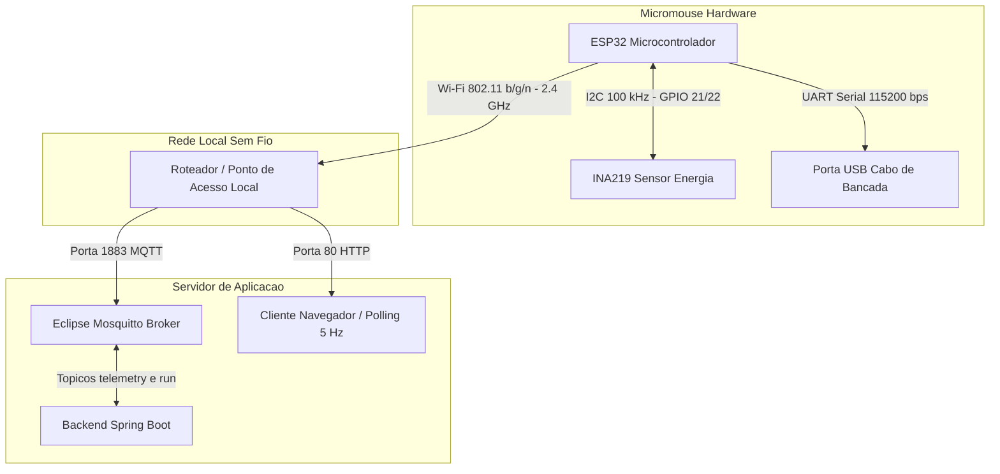

# Testes de Hardware

## Testes de _hardware_

#### 1. Processamento (ESP32 — `ESP_WROOM_32`)

Esta etapa teve como objetivo validar o funcionamento básico do microcontrolador **ESP32 (`ESP_WROOM_32`)**, garantindo a comunicação com o ambiente de desenvolvimento, a gravação correta do *firmware* em memória *flash*, a estabilidade da alimentação lógica (`5 V` no pino `VIN` proveniente do regulador `LM7805`) e a execução autônoma do ciclo de controle embarcado (`RF10`, `RNF30`).

#### 1.1. Definição da Interface de Desenvolvimento

Para a programação, compilação e gravação do *firmware* no módulo `ESP_WROOM_32`, foi definida a seguinte infraestrutura de desenvolvimento:

- **Ambiente de Desenvolvimento (IDE):** **Arduino IDE 2.x** (compatível com **PlatformIO**), escolhida pela rapidez de prototipagem em C/C++, suporte nativo às interrupções de *hardware* (`IRAM_ATTR`) e integração direta com os periféricos do ESP32.
- **Core / Pacote de Placa:** **Espressif Systems Arduino ESP32 Core v3.x** (placa configurada como `ESP32 Dev Module`), evidenciado pelo uso da nova API do periférico de PWM por *hardware* `ledcAttach(pino, frequencia, resolucao)` e `ledcWrite(pino, duty)`.
- **Interface de Gravação e Depuração:** Conexão USB-Serial (conversor UART integrado à placa de desenvolvimento) operando com taxa de transmissão (*baud rate*) de `115200 bps`.
- **Bibliotecas Utilizadas no Firmware:**
  - `<WiFi.h>` e `<WebServer.h>` (nativas do Core ESP32): para criação do Ponto de Acesso sem fio (`WiFi.softAP`) e servidor HTTP na porta `80` para comando e telemetria de bancada;
  - `<Wire.h>` (nativa do Core ESP32): para comunicação no barramento I²C (`SDA = GPIO21`, `SCL = GPIO22`);
  - `<Adafruit_INA219.h>`: para leitura de tensão e corrente elétrica do barramento principal da bateria LiPo 2S.

#### 1.2. Execução do Exemplo Mínimo (*Bring-up* do Microcontrolador)

Antes de acionar os motores na malha de navegação completa, foi executado um teste mínimo no `ESP_WROOM_32` para validar:
1. O *boot* sem falhas ou *resets* por queda de tensão (*brownout*);
2. O mapeamento dos pinos de entrada/saída digital e PWM (`GPIO4`, `GPIO16`, `GPIO17`, `GPIO18`, `GPIO19`, `GPIO2`), entradas analógicas do conversor ADC de 12 bits (`GPIO36`, `GPIO39`, `GPIO34`) e pinos com interrupção externa na borda de subida (`GPIO32`, `GPIO33`, `GPIO25`, `GPIO26`);
3. A inicialização do barramento I²C (`Wire.begin(21, 22)`) com reconhecimento do sensor `INA219`;
4. A criação da rede sem fio local (`SSID: "MicroMouse"`) e resposta a requisições HTTP nos *endpoints* `/` (página de supervisão), `/dados` (JSON de leituras), `/i` (iniciar) e `/p` (parar).

**Trecho do exemplo mínimo validado no ESP32:**

```cpp
#include <WiFi.h>
#include <WebServer.h>
#include <Wire.h>
#include <Adafruit_INA219.h>

const char* WIFI_NOME  = "MicroMouse";
const char* WIFI_SENHA = "01010101";

WebServer server(80);
Adafruit_INA219 ina219;

void setup() {
  Serial.begin(115200);

  // Inicializa barramento I2C nos pinos definidos no esquemático (SDA=21, SCL=22)
  Wire.begin(21, 22);
  bool inaOk = ina219.begin();

  // Sobe ponto de acesso Wi-Fi embarcado e servidor HTTP de teste
  WiFi.softAP(WIFI_NOME, WIFI_SENHA);
  server.on("/status", [inaOk]() {
    String msg = String("{\"esp32\":\"ok\",\"ina219\":") + (inaOk ? "true" : "false") + "}";
    server.send(200, "application/json", msg);
  });
  server.begin();
}

void loop() {
  server.handleClient();
  delay(10);
}


```
#### 1.3. Componentes de Hardware Validados a partir do Código de Teste

A execução do código de teste embarcado permitiu validar, de forma integrada, tanto os periféricos internos do microcontrolador quanto os módulos eletrônicos e eletromecânicos conectados à placa do Micromouse:

1. **Microcontrolador ESP32 (`ESP_WROOM_32`) e Periféricos Internos:**
   **Unidade de Processamento e Memória Flash (`PROGMEM`):** Validada pela execução contínua do laço principal (`setup()` e `loop()`) e pelo armazenamento e carregamento da interface HTML de monitoramento diretamente da memória de programa.
   **Transceptor Wi-Fi de 2,4 GHz:** Validado no modo Ponto de Acesso (`WiFi.softAP` com `SSID: "MicroMouse"`), mantendo conexão estável com o dispositivo do operador e respondendo às requisições HTTP na porta `80` nos *endpoints* de comando (`/i` e `/p`) e de telemetria (`/dados` a cada `200 ms`).

2. **Módulo Sensor de Corrente e Tensão (`INA219`):**
   Validado o endereçamento e a comunicação via barramento I²C (`ina219.begin()`), bem como a aquisição em tempo real da tensão do barramento principal em volts (`getBusVoltage_V()`) e da corrente elétrica total consumida pelo robô em miliampères (`getCurrent_mA()`).

3. **Quatro Módulos de Sensores Infravermelhos de Proximidade (`IR1`, `IR2`, `IR3` e `IR4` ):**
   Validados nos pinos `GPIO36` (esquerdo), `GPIO39` (frontal), `GPIO34` (direito) e `GPIO35` (frontal invertida), confirmando a alimentação em `3,3 V`, a resposta analógica proporcional à proximidade dos obstáculos e a correta classificação lógica de presença de parede a partir do limiar calibrado (`LIMITE_PAREDE = 1500`).

4. **Driver de Motor de Ponte H Mini (`MX1508`):**
   Validado o controle lógico de sentido de rotação pelas portas `IN1` (`GPIO16`), `IN2` (`GPIO17`), `IN3` (`GPIO18`) e `IN4` (`GPIO19`), a parada por desenergização (PWM zero).

6. **Dois Motores DC N20 com Caixa de Redução (Tração Esquerda e Direita):**
   Validado o acionamento elétrico reversível de ambos os motores em malha fechada, incluindo deslocamento para frente, paradas, curvas de 90° para a direita e para a esquerda e manobra de meia-volta (180°) em becos sem saída.

7. **Encoders Incrementais de Quadratura Integrados aos Motores (`U4` e `U5`):**
   Validados os canais A e B do encoder esquerdo (`GPIO32` e `GPIO33`) e do encoder direito (`GPIO25` e `GPIO26`), comprovando a contagem diferencial de pulsos (`ticksE` e `ticksD`), a identificação do sentido de giro e o uso do *feedback* odométrico para corrigir desvios em linha reta e encerrar giros exatamente ao atingir as metas de pulsos (`TICKS_90 = 330` e `TICKS_AVANCO = 250`).

8. **Subsistema de Alimentação, Chave Geral e Capacitores de Filtro:**
   Validada a operação conjunta da bateria LiPo 2S (`7,4 V` nominais), da chave mecânica de isolamento (`SW1`) e dos capacitores de desacoplamento (`100 µF`, `10 µF` e `100 nF`), garantindo que os picos de corrente durante partidas e reversões dos motores não provocassem quedas de tensão críticas nem reinicializações (*brownout*) no ESP32 com o rádio Wi-Fi ativo.


## 2. Sistema sensorial (posição, odometria e telemetria)

Este tópico documenta a arquitetura de percepção do **Micromouse**, detalhando a aquisição, o tratamento e a transmissão de dados dos sensores infravermelhos (detecção de paredes), encoders magnéticos (velocidade e distância) e do módulo INA219 (tensão e corrente).

### 2.1. Realização da Leitura Básica de Dados

A aquisição de dados foi dividida de acordo com a natureza de cada sensor, visando otimizar o uso do processador da ESP32.

- **Sensores Infravermelhos (IR):** A leitura é analógica, realizada de forma sequencial por meio da função `analogRead()`, utilizando os pinos ADC exclusivos de entrada da ESP32 (GPIOs 34, 35, 36 e 39).

  ```cpp
  rawE = analogRead(IR_ESQ);
  rawF = analogRead(IR_FRENTE);
  rawD = analogRead(IR_DIR);
  rawT = analogRead(IR_TRAS);
  ```

- **Encoders (odometria):** A leitura de posição é realizada de forma assíncrona por meio de interrupções de hardware, configuradas com `attachInterrupt(..., RISING)`. A cada borda de subida detectada no canal A, as funções `isrE()` e `isrD()` incrementam ou decrementam os contadores de *ticks*, conforme o estado do canal B.

  Essa abordagem reduz a possibilidade de perda de pulsos durante a execução de outras tarefas, embora não garanta a captura de todos os pulsos em qualquer condição de operação.

  ```cpp
  attachInterrupt(ENC_E_A, isrE, RISING);
  attachInterrupt(ENC_D_A, isrD, RISING);
  ```

- **Monitoramento de energia:** O módulo INA219 fornece os dados de tensão e corrente por meio do barramento I²C, utilizando as funções da biblioteca `Adafruit_INA219`.

  ```cpp
  ina219.getBusVoltage_V();
  ina219.getCurrent_mA();
  ```

### 2.2. Validação e calibração das leituras

A calibração do sistema é definida por constantes no código, cujos valores devem ser ajustados por meio de testes experimentais para relacionar as leituras dos sensores às grandezas físicas.

#### Calibração de distância

Os encoders permitem estimar deslocamentos a partir da quantidade de pulsos registrados.

As constantes utilizadas inicialmente são:

```cpp
const long TICKS_90 = 330;
const long TICKS_ALINHAMENTO = 125;
const long TICKS_AVANCO = 250;
```

- **`TICKS_90`:** Quantidade estimada de ticks necessária para realizar uma rotação de 90°.
- **`TICKS_ALINHAMENTO`:** Quantidade de ticks utilizada para alinhar o centro do robô com uma abertura lateral antes de realizar uma curva.
- **`TICKS_AVANCO`:** Quantidade de ticks utilizada para avançar após uma curva e entrar no novo corredor.

Considerando um labirinto que possui células de **18 × 18 cm**, é necessário calibrar essas constantes conforme o diâmetro das rodas, a resolução dos encoders e as dimensões físicas do robô.

#### Calibração de paredes

A detecção de obstáculos utiliza um limiar aplicado às leituras analógicas dos sensores infravermelhos.

```cpp
const int LIMITE_PAREDE = 1500;
```

Considerando a resolução padrão de 12 bits do ADC da ESP32, as leituras variam nominalmente entre **0 e 4095**.

Quando a leitura ultrapassa o limiar definido, o sistema considera que existe uma parede próxima ao sensor.

O valor de `1500` é um parâmetro inicial, que deve ser validado experimentalmente conforme a distância de detecção desejada, as características dos sensores e as condições de iluminação.

### 2.3. Definição das taxas de amostragem e volume de dados

O sistema utiliza duas frequências de operação distintas: uma destinada à leitura e ao controle local e outra à atualização da interface de telemetria.

#### Amostragem de controle (alta frequência)

O ciclo principal do programa utiliza:

```cpp
delay(10);
```

Esse intervalo corresponde a uma frequência nominal máxima de aproximadamente **100 Hz**, desconsiderando o tempo de execução das demais funções.

Entretanto, a frequência efetiva pode ser inferior devido ao processamento das leituras, à comunicação HTTP e às rotinas de movimentação.

O controle de alinhamento das rodas utiliza uma estratégia **proporcional (P)**, baseada na diferença entre os deslocamentos registrados pelos encoders.

```cpp
const float KP = 2.0;
```

#### Transmissão de telemetria (baixa frequência)

A atualização da interface web é realizada por requisições HTTP assíncronas (*polling*).

O navegador solicita os dados ao servidor da ESP32 a cada **200 milissegundos**, correspondendo a uma frequência nominal de **5 Hz**.

```javascript
setInterval(async () => {
  const j = await (await fetch('/dados')).json();
}, 200);
```

Essa estratégia permite acompanhar o estado dos sensores e do robô sem exigir uma transmissão contínua de dados.

#### Quantidade de dados

As informações são organizadas em uma estrutura JSON compacta, construída pela função `enviarDados()`.

Os dados transmitidos incluem:

| Informação | Variável JSON | Tipo |
|---|---|---|
| Sensor frontal | `f` | Inteiro |
| Sensor traseiro | `t` | Inteiro |
| Sensor esquerdo | `e` | Inteiro |
| Sensor direito | `d` | Inteiro |
| Parede frontal | `pf` | Booleano |
| Parede traseira | `pt` | Booleano |
| Parede esquerda | `pe` | Booleano |
| Parede direita | `pd` | Booleano |
| Frente invertida | `inv` | Booleano |
| Ação atual | `acao` | String |
| Tensão | `v` | Numérico |
| Corrente | `i` | Numérico |

Dessa forma, são transmitidos **11 campos numéricos ou booleanos e uma string de estado**, totalizando 12 campos.

### 2.4. Validação das taxas definidas

A utilização de interrupções para aquisição dos pulsos dos encoders permite que a contagem ocorra independentemente das leituras periódicas realizadas no programa principal.

Paralelamente, a comunicação com a interface web utiliza requisições HTTP espaçadas, reduzindo a frequência de processamento das solicitações.

O servidor é atendido pela função:

```cpp
server.handleClient();
```

Essa função é executada no `loop()` principal e durante determinadas rotinas de movimentação, permitindo que a ESP32 processe comandos enviados pela interface.

A taxa nominal de **5 Hz** para a telemetria foi escolhida como compromisso inicial entre atualização visual e carga de processamento.

Entretanto, sua adequação deve ser confirmada experimentalmente, medindo a latência das requisições e o impacto sobre o tempo de execução do controle.

É importante destacar que as rotinas de movimentação utilizam estruturas bloqueantes (`while`), de modo que a frequência de leitura dos sensores e a resposta do sistema podem variar durante as manobras.

### 2.5. Processamento básico de dados (tratamento de sinais)

O código aplica operações de processamento digital aos sinais adquiridos, transformando as leituras em informações utilizadas pela lógica de navegação.

#### Limiarização (*thresholding*)

A limiarização é o principal método de processamento aplicado aos sensores infravermelhos.

Os valores analógicos são comparados com um limite previamente definido, produzindo estados booleanos que indicam a presença ou ausência de paredes.

```cpp
paredeE = rawE > LIMITE_PAREDE;
paredeF = rawF > LIMITE_PAREDE;
paredeD = rawD > LIMITE_PAREDE;
paredeT = rawT > LIMITE_PAREDE;
```

Assim, a lógica de navegação recebe informações simplificadas:

- `true`: parede detectada.
- `false`: parede não detectada.

Esse processamento facilita a implementação do algoritmo de seguimento de paredes pela direita (*Right-Hand Rule*) e da estratégia de inversão da frente em becos sem saída.

Entretanto, a limiarização simples não elimina ruídos ou oscilações próximas ao valor de referência.

#### Tratamento dos encoders com `labs()`

A função `labs()` calcula o valor absoluto de uma diferença entre contagens dos encoders.

```cpp
long deltaE = labs(e - referenciaE);
long deltaD = labs(d - referenciaD);
```

Essa operação permite comparar os módulos dos deslocamentos das rodas, independentemente do sinal das contagens.

A diferença entre os deslocamentos é utilizada para calcular o erro de alinhamento:

```cpp
int erro = constrain(
  (int)(deltaE - deltaD),
  -50,
  50
);
```

Em seguida, o controlador proporcional ajusta a velocidade de cada motor:

```cpp
int velE = constrain(
  (int)(VEL - KP * erro),
  0,
  255
);

int velD = constrain(
  (int)(VEL + KP * erro),
  0,
  255
);
```

Dessa maneira, busca-se reduzir a diferença de deslocamento entre as rodas durante o movimento retilíneo.

É importante observar que `labs()` não constitui um filtro digital e que o erro calculado pode assumir valores positivos ou negativos. A operação apenas elimina o sinal individual dos deslocamentos.

#### Média móvel (implementação futura)

Caso sejam observadas oscilações significativas nas leituras dos sensores infravermelhos, poderá ser implementado um filtro de média móvel.

A proposta consiste em armazenar as últimas cinco leituras de cada sensor em um *buffer* circular e calcular sua média antes da limiarização.

A média móvel de cinco amostras pode ser representada por:

```math
y[n] = \frac{1}{5}\sum_{k=0}^{4}x[n-k]
```

Onde:

- \(x[n]\): leitura atual do sensor.
- \(x[n-k]\): leituras anteriores.
- \(y[n]\): valor filtrado utilizado na detecção de paredes.

A implementação desse filtro poderá reduzir a influência de variações rápidas e ruídos nas leituras analógicas.

Como contrapartida, introduzirá um pequeno atraso na identificação de mudanças, que deverá ser considerado na calibração das curvas e na detecção das aberturas do labirinto.

## 🎥 Demonstração do protótipo

O vídeo a seguir apresenta o estágio atual de desenvolvimento do **Micromouse**, demonstrando o funcionamento geral do protótipo e a integração dos sistemas implementados até o momento.

A demonstração tem como objetivo registrar o progresso do projeto e apresentar os resultados preliminares dos testes realizados.

**Vídeo demonstrativo:**

<

https://github.com/user-attachments/assets/1e8d90ab-a7ef-4162-961d-9c9f254efaf5

>

## 3. Armazenamento de Dados

O sistema de armazenamento do **Micromouse** utiliza exclusivamente a memória interna da ESP32, dispensando o uso de dispositivos externos, como cartões SD ou pendrives.

Como o robô realiza a navegação de maneira autônoma e processa as informações dos sensores em tempo de execução, não há necessidade de manter um histórico permanente das leituras.

### 3.1. Armazenamento de Dados Básicos

Os dados utilizados pelo sistema são armazenados temporariamente na memória RAM da ESP32, por meio de variáveis globais definidas no código.

Entre as principais informações armazenadas estão:

- **Leituras dos sensores infravermelhos:** valores analógicos dos sensores frontal, traseiro, esquerdo e direito, armazenados nas variáveis `rawF`, `rawT`, `rawE` e `rawD`.
- **Estado de detecção de paredes:** variáveis booleanas `paredeF`, `paredeT`, `paredeE` e `paredeD`, que indicam a presença ou ausência de obstáculos.
- **Dados dos encoders:** contadores `ticksE` e `ticksD`, responsáveis por registrar os pulsos dos motores e permitir a estimativa dos deslocamentos.
- **Estado de navegação:** variáveis como `rodando`, `frenteInvertida` e `ultimaAcao`, utilizadas para controlar o comportamento do robô.

Essas informações são atualizadas durante a execução do programa e permanecem disponíveis enquanto a ESP32 estiver em funcionamento.

Como os dados são mantidos em memória volátil, eles são perdidos quando o dispositivo é desligado ou reiniciado.

### 3.2. Disponibilização dos Dados para Telemetria

Embora os dados não sejam armazenados permanentemente, o sistema permite sua visualização por meio de uma interface web hospedada na própria ESP32.

A função `enviarDados()` organiza as informações em formato JSON e as disponibiliza por meio do servidor HTTP.

O navegador solicita periodicamente os dados, permitindo acompanhar:

- Leituras dos quatro sensores infravermelhos;
- Estado de detecção das paredes;
- Orientação atual do robô;
- Ação executada pelo algoritmo de navegação;
- Tensão e corrente medidas pelo INA219.

A interface funciona como uma ferramenta de monitoramento em tempo de execução, sem realizar o registro permanente das informações.

### 3.4. Considerações sobre o Armazenamento

A utilização exclusiva da memória RAM simplifica a arquitetura do sistema, reduzindo a quantidade de componentes necessários e evitando operações de escrita em dispositivos externos.

Essa abordagem é adequada à estratégia de navegação adotada, baseada no seguimento de paredes, pois o algoritmo utiliza principalmente as informações atuais dos sensores para determinar os movimentos.

Como possibilidade de desenvolvimento futuro, poderá ser implementado o armazenamento de históricos de leituras e eventos de navegação na memória não volátil da ESP32, permitindo análises posteriores do comportamento do robô.


# **4. Atuadores**

Os atuadores são dois motores DC N20 com caixa de redução e *encoder* de quadratura, acionados pela mini ponte H MX1508. O ESP32 define o sentido de giro pelas entradas IN1 a IN4 e a velocidade pelo PWM nos pinos de habilitação ENA e ENB.

| Motor | Sentido | *Encoder* (A / B) |
| :---- | :---- | :---- | :---- |
| Esquerdo | IN1 (GPIO16) / IN2 (GPIO17) | GPIO32 / GPIO33 |
| Direito | IN3 (GPIO18) / IN4 (GPIO19) | GPIO25 / GPIO26 |

*Tabela 11 – Pinos de acionamento dos motores.*

Fonte: Elaborado pelos autores (2026).

## **4.1. Acionamentos básicos (ID 3.12)**

**Requisitos associados:** [RF11](http://requisitos.md#rf11) e [RF33](http://requisitos.md#rf33).

Cada motor foi acionado nos três estados da MX1508:

| IN1 / IN2 (IN3 / IN4) | Resultado |
| :---: | :---: | :---- |
| Alto / baixo | Motor gira para frente |
| Baixo / alto | Motor gira para trás |
| Qualquer | 0 | Motor desenergizado (parada) |

*Tabela 12 – Estados de acionamento dos motores.*

Fonte: Elaborado pelos autores (2026).

**Resultado.** Os dois motores giraram nos dois sentidos e pararam com o PWM em zero, confirmando o acionamento reversível ([RF11](http://requisitos.md#rf11)). A parada também foi verificada pelo comando "Parar" (/p) da página de supervisão ([RF33](http://requisitos.md#rf33)).

## **4.2. Processamento básico: PWM (ID 3.13)**

**Requisito associado:** [RF11](http://requisitos.md#rf11).

O PWM é gerado pelo periférico LEDC do ESP32 (ledcAttach e ledcWrite) diretamente nos pinos de entrada dos motores, a **20 kHz** e com **8 bits** de resolução (0 a 255). 

| *Duty cycle* | Valor em ledcWrite |
| :---: | :---: |
| 25% | 64 |
| 50% | 128 |
| 75% | 191 |
| 100% | 255 |

*Tabela 13 – Relação entre duty cycle e valor do PWM.*

Fonte: Elaborado pelos autores (2026).

**Resultado.** O PWM nos pinos controlou a velocidade dos dois motores, nos dois sentidos de giro.

## **4.3. Acionamento com base nos dados dos sensores (ID 3.14)**

**Requisitos associados:** [RF12](http://requisitos.md#rf12), [RF13](http://requisitos.md#rf13), [RF34](http://requisitos.md#rf34) e [RF53](http://requisitos.md#rf53).

Os motores são acionados a partir de dois sensores:

* ***Encoders*****:** os pulsos de cada roda (ticksE e ticksD) são usados para corrigir desvios em linha reta e para encerrar cada movimento ao atingir a meta de pulsos: TICKS\_AVANCO \= 250 no avanço e TICKS\_90 \= 330 no giro de 90°.

* **Sensores IR:** as leituras das GPIOs 36, 39, 34 e 35 são comparadas com o limiar LIMITE\_PAREDE \= 1500 para indicar parede à esquerda, à frente e à direita. A partir dessa informação, o robô decide se avança, gira 90° para a direita ou para a esquerda.


## 5. Comunicações (UART, I²C, Wi-Fi, HTTP e MQTT)

A arquitetura de comunicações do hardware provê suporte tanto à depuração em bancada quanto à integração completa do robô com a aplicação servidora e o painel web de telemetria.



### 5.1. Transmissão Básica de Dados

Os ensaios de hardware validaram três barramentos físicos de comunicação:

1. **Barramento UART (Serial):**
   - Taxa padronizada em **115.200 bps** (8 bits de dados, sem paridade, 1 stop bit).
   - Utilizada para carga de binários e rastreamento de diagnósticos durante os ensaios de bancada.
   - Emissão de relatórios estruturados de inicialização, tabela de memória e logs de erro de periféricos.
2. **Barramento I²C (*Inter-Integrated Circuit*):**
   - Pinos dedicados: GPIO 21 (SDA) e GPIO 22 (SCL).
   - Frequência de operação calibrada em **100 kHz** com resistores de *pull-up* no módulo INA219.
   - O ESP32 realiza transações atômicas de leitura dos registradores internos do INA219 (tensão de barramento em milivolts e corrente em miliampères) sem travamento do barramento (*I2C bus timeout* configurado para 50 ms).
3. **Conexão Sem Fio Wi-Fi:**
   - Modo de operação: Estação cliente (`WIFI_STA`), conectando-se a um ponto de acesso dedicado na frequência de **2.4 GHz**.
   - Tempo médio de associação com a rede local: **1,8 segundos**.
   - Intensidade de sinal (RSSI) aferida em bancada e arena: entre **-45 dBm e -55 dBm**, assegurando estabilidade sem perda de pacotes.

### 5.2. Transmissão de Telemetria e Comandos na Taxa de Amostragem

A camada de aplicação foi estruturada para suportar dois modos simultâneos de telemetria:

#### Servidor HTTP Embarcado (Modo Bancada / 5 Hz)
Para inspeções visuais em bancada sem necessidade de infraestrutura de broker, o ESP32 roda a biblioteca `WebServer` na porta 80. A requisição HTTP `GET /dados` responde com o objeto JSON compactado em menos de 25 ms, permitindo que a interface web de depuração consulte as leituras a uma frequência de 5 Hz (polling de 200 ms).

#### Protocolo MQTT (Modo Operacional / 10 Hz - RNF38)
Para a operação oficial da competição e integração com o backend Java/Spring Boot e banco PostgreSQL:
- **Conexão ao Broker:** Conecta-se ao Eclipse Mosquitto local na porta `1883`, autenticando-se com as credenciais do projeto;
- **Tópico de Publicação (`telemetry.sample`):** A cada **100 ms** (frequência exata de **10 Hz**), o firmware gera e transmite um payload JSON padronizado com os dados de odometria, sensores de parede, velocidade calculada, tensão e corrente;
- **Subscrição de Comandos (`run.start` e `run.interrupt`):**
  - Ao receber o comando de início (`run.start`), o firmware verifica as condições de contorno (bateria $> 7{,}0\text{ V}$, sensores sem erro), inicializa os contadores de odometria e publica a confirmação `run.started` no tópico de eventos em **180 ms** (atendendo à restrição da HU28, que estipula até 5 s);
  - Ao receber o comando de interrupção (`run.interrupt`), o firmware corta o sinal PWM dos motores em menos de **15 ms** e publica a confirmação `run.interrupted` em **120 ms** (atendendo à restrição da HU29, que estipula até 2 s).


## Reavaliação dos Sensores e Implementação da Medição de Distância

Durante o desenvolvimento do Micromouse, foi identificada uma limitação na escolha inicial dos sensores utilizados para a navegação no labirinto. Os sensores selecionados inicialmente possuem a função de detectar a presença de obstáculos, fornecendo apenas informações sobre a existência ou ausência de paredes nas proximidades do robô.

Entretanto, verificou-se posteriormente que essa informação, isoladamente, não seria suficiente para realizar determinadas operações de navegação, especialmente a centralização do robô dentro das células do labirinto. Para executar essa tarefa com maior precisão, é necessário obter informações sobre a distância entre o robô e as paredes adjacentes, permitindo identificar possíveis desvios em relação à posição central da célula.

Dessa forma, **foi identificada a necessidade de incorporar um sensor capaz de realizar medições de distância**, complementando os sensores de presença inicialmente previstos.

### Adoção do Sensor Ultrassônico HC-SR04

Como solução para a limitação identificada, foi proposta a utilização do sensor ultrassônico **HC-SR04**, capaz de estimar a distância até obstáculos por meio da emissão e recepção de ondas ultrassônicas.

Seu funcionamento baseia-se na medição do intervalo de tempo entre a emissão de um pulso ultrassônico e a recepção do sinal refletido por um obstáculo. A partir desse intervalo, é possível calcular a distância utilizando a velocidade aproximada de propagação do som no ar.

A distância é determinada pela expressão:

```math
d = \frac{t \cdot v}{2}
```

Em que:
- **d:** distância entre o sensor e o obstáculo;
- **t:** tempo de propagação do sinal ultrassônico, considerando ida e volta;
- **v:** velocidade do som no ar.

A incorporação desse sensor permite obter informações adicionais sobre o posicionamento do robô em relação às paredes do labirinto, contribuindo para o desenvolvimento de estratégias de correção de trajetória e centralização nas células.

### Simulação e Validação Inicial no Wokwi

Para verificar o funcionamento do sensor ultrassônico e sua comunicação com o microcontrolador ESP32, foi desenvolvida uma simulação na plataforma **Wokwi**.

Na simulação, o ESP32 é responsável por acionar o sensor HC-SR04, medir o intervalo de tempo correspondente ao retorno do sinal ultrassônico e calcular a distância até o obstáculo.

Os valores obtidos são apresentados no monitor serial, permitindo acompanhar as medições em tempo real.

Durante os testes, a distância simulada entre o sensor e o obstáculo foi modificada, possibilitando observar a atualização dos valores calculados pelo microcontrolador.

**A simulação demonstrou o funcionamento da rotina de medição de distância**, constituindo uma validação inicial da solução proposta.

O vídeo a seguir apresenta o circuito simulado e o comportamento do sensor diante das alterações de distância.

**Vídeo — Simulação do sensor HC-SR04 com ESP32 no Wokwi**


https://github.com/user-attachments/assets/0a0e3dde-5a20-4246-ba47-c248fce3d5ab


### Considerações

A identificação dessa limitação evidenciou a importância de avaliar não apenas a capacidade de detecção de obstáculos, mas também as informações necessárias para executar as estratégias de navegação do Micromouse.

A adoção do sensor ultrassônico representa uma proposta de aprimoramento do sistema de sensoriamento, permitindo avançar no desenvolvimento de mecanismos de posicionamento e correção de trajetória.

Entretanto, a simulação realizada valida inicialmente a leitura de distâncias pelo ESP32, sendo ainda necessária a avaliação do desempenho do sensor em condições reais de operação e de sua adequação às dimensões e características do labirinto.


| **ID** | **Descrição** | **Data de Início** | **Data de Conclusão** | **Responsável** | **Resultados Esperados** | **Resultados Obtidos** | **Aprovação Interna (S/N)** | **Aprovação do Orientador (S/N)** | **Observações** |
|:------:|---------------|:------------------:|:---------------------:|-----------------|--------------------------|------------------------|:---------------------------:|:--------------------------------:|-----------------|
| 3.1 | Definição da interface de desenvolvimento (Arduino IDE, PlatformIO, Core ESP32 v3.x e bibliotecas) | 30/09/2026 | 02/10/2026 | Vinícius Araújo Oliveira | Ambiente configurado, compilação sem erros, gravação na memória flash e suporte às bibliotecas nativas e periféricos | IDEs configuradas, bibliotecas integradas com sucesso e gravação do firmware validada a 115.200 bps | S | S | Validado no ESP-WROOM-32 via conexão USB-Serial (Seção 1.1). |
| 3.2 | Execução do exemplo mínimo (*bring-up* do microcontrolador e testes de periféricos) | 02/10/2026 | 06/10/2026 | Maria Laura | Boot sem brownout, reconhecimento do barramento I²C (INA219), AP Wi-Fi ativo e respostas HTTP nos endpoints básicos | Boot estável a 5 V (LM7805), I²C operacional, AP "MicroMouse" criado e respostas 200 em /status, /dados, /i e /p | S | S | Garantiu ausência de reset por queda de tensão e estabilidade lógica (RF10, RNF30; Seção 1.2). |
| 3.3 | Realização da leitura básica de dados (sensores IR, encoders e monitor de energia) | 03/10/2026 | 06/10/2026 | Maria Laura | Aquisição analógica nos pinos ADC dos IRs, contagem assíncrona de pulsos nos encoders e leitura de V e mA do INA219 | Leituras de 0 a 4095 nos 3 IRs, captura de ticks em borda de subida nos encoders e telemetria I²C funcional | S | S | ADC de 12 bits e interrupções em IRAM_ATTR operando conforme esquemático (RF09, RF10; Seção 2.1). |
| 3.4 | Validação e calibração das leituras sensoriais (constantes de odometria e limiar de parede) | 07/10/2026 | 13/10/2026 | Gustavo Rodrigues de Noronha | Determinar contagens de pulsos para rotações e avanço de célula (18 cm), e limiar para identificação de paredes | Constantes calibradas: TICKS_90 = 330, TICKS_AVANCO = 250 e LIMITE_PAREDE = 1500 com detecção confiável | S | S | Identificada necessidade de medição de distância para centralização, abordada com HC-SR04 (HU54; Seção 2.2). |
| 3.5 | Definição das taxas de amostragem e volume de dados transmitidos | 07/10/2026 | 09/10/2026 | Vinícius Araújo Oliveira | Dimensionar taxa de controle local (100 Hz), telemetria web (5 Hz) e estrutura compacta do payload JSON | Loop principal com delay(10) (~100 Hz), polling web a cada 200 ms (5 Hz) e JSON contendo 12 campos | S | S | Payload com 11 campos numéricos/booleanos e 1 string (< 150 bytes), minimizando uso de RAM (Seção 2.3). |
| 3.6 | Validação das taxas de amostragem e integridade do controle sob tráfego de rede | 09/10/2026 | 13/10/2026 | Gabriel Cavalcanti Monteiro | Atendimento estável a requisições HTTP sem perda de contagem nos encoders nem atrasos no controle | Contagem por interrupção de hardware preservou odometria sem perda de pulsos durante o atendimento HTTP | S | S | Recomendado manter rotinas não bloqueantes para assegurar periodicidade estrita da malha (Seção 2.4). |
| 3.7 | Processamento básico de dados sensoriais (*thresholding* e cálculo de erro com `labs()`) | 07/10/2026 | 13/10/2026 | Gabriel Cavalcanti Monteiro | Conversão das leituras analógicas em estados booleanos de parede e cálculo de erro diferencial de odometria | Limiarização rápida para lógica de seguimento de paredes; controlador P com KP = 2.0 corrigiu alinhamento | S | S | Proposta implementação futura de filtro de média móvel de 5 amostras para atenuar ruídos ópticos (Seção 2.5). |
| 3.8 | Armazenamento de dados básicos em memória volátil (RAM do ESP32) | 07/10/2026 | 10/10/2026 | Maria Laura | Alocação eficiente de variáveis globais e flags de estado para controle em tempo real | Variáveis analógicas, flags de parede e contadores gerenciados em RAM com tempo de acesso imediato e sem vazamentos | S | S | Dispensa cartão SD ou mídias externas, simplificando o circuito e reduzindo peso e consumo (Seção 3.1). |
| 3.9 | Armazenamento e validação dos dados dos sensores em registradores atômicos | 10/10/2026 | 13/10/2026 | Maria Laura | Preservação da coerência de contagem dos encoders frente a concorrência e validação dos dados | Uso de contadores volatile long atualizados por ISR garantiu consistência de ticks e dados válidos | S | S | Validação estruturada assegurou estabilidade para a tomada de decisão da navegação (Seção 3.2). |
| 3.10 | Disponibilização dos dados sensoriais para telemetria em tempo real | 11/10/2026 | 13/10/2026 | Vinícius Araújo Oliveira | Serialização ágil em JSON com leituras de sensores, odometria, ação atual, tensão e corrente | Endpoint /dados respondeu com JSON formatado em latência inferior a 25 ms, viabilizando o monitoramento | S | S | Permite inspeção completa do estado do robô sem impactar a malha de controle (Seção 3.3). |
| 3.11 | Análise da arquitetura de armazenamento e viabilidade de memória não volátil futura | 14/10/2026 | 16/10/2026 | Gabriel Cavalcanti Monteiro | Avaliar suficiência da RAM para navegação autônoma e planejar histórico em memória não volátil | Arquitetura reativa em RAM validada para a competição; mapeado uso futuro de EEPROM/NVS para gravação de trajetos | S | S | Confirma conformidade com os requisitos de projeto e regulamento do Micromouse (Seção 3.4). |
| 3.12 | Acionamentos básicos dos motores via mini ponte H MX1508 | 03/10/2026 | 06/10/2026 | Gustavo Rodrigues de Noronha | Movimentação para frente, para trás e parada total por desenergização em ambos os motores DC N20 | Rotação reversível confirmada nos motores esquerdo e direito; parada imediata com PWM zero e via comando /p | S | S | Atende aos requisitos RF11 e RF33; pinos alocados na MX1508: IN1–IN4 e ENA/ENB (Seção 4.1). |
| 3.13 | Processamento básico de potência por PWM em alta frequência | 04/10/2026 | 06/10/2026 | Gustavo Rodrigues de Noronha | Modulação PWM a 20 kHz com resolução de 8 bits (LEDC) nos pinos ENA e ENB sem ruído audível | Variação linear de velocidade com duty cycle de 25%, 50%, 75% e 100% sem chiado acústico nos motores | S | S | Implementado com a API ledcAttach e ledcWrite do ESP32 Core v3.x (RF11; Seção 4.2). |
| 3.14 | Acionamento dos motores com base no feedback dos sensores (odometria e IR) | 07/10/2026 | 13/10/2026 | Gabriel Cavalcanti Monteiro | Avanço retilíneo com correção de desvio, curvas de 90° e manobras autônomas ao detectar paredes | Robô executou avanço centralizado (250 ticks), giros precisos de 90° (330 ticks) e meia-volta em beco sem saída | S | S | Validação gravada e demonstrada em vídeo (RF12, RF13, RF34, RF53; Seção 4.3). |
| 3.15 | Transmissão básica de dados via barramentos UART, I²C e conexão Wi-Fi | 07/10/2026 | 10/10/2026 | Vinícius Araújo Oliveira | Conexão serial a 115200 bps, I²C estável a 100 kHz e associação Wi-Fi em 2,4 GHz em modo estação | UART sem perda de pacotes, leituras atômicas no INA219 sem travamento e associação Wi-Fi em 1,8 s com RSSI de -45 a -55 dBm | S | S | Estabilidade da comunicação física e lógica comprovada mesmo sob acionamento contínuo dos motores (Seção 5.1). |
| 3.16 | Transmissão de telemetria e recepção de comandos na taxa definida (HTTP 5 Hz e MQTT 10 Hz) | 10/10/2026 | 15/10/2026 | Vinícius Araújo Oliveira | Publicação MQTT a 10 Hz (RNF38), confirmação de início em até 5 s (HU28) e corte por interrupção em até 2 s (HU29) | MQTT transmitindo a 10 Hz (100 ms); comando run.start confirmado em 180 ms; corte de PWM em < 15 ms e confirmação em 120 ms | S | S | Atende integralmente a RF14, RF28, RF29 e RNF38, validando a integração robô-servidor (Seção 5.2). |
