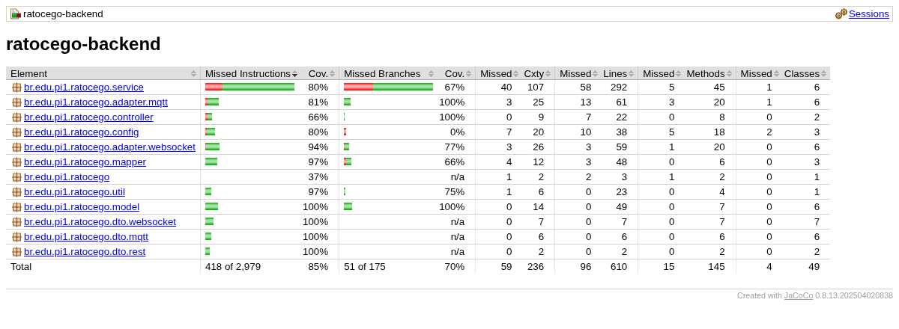
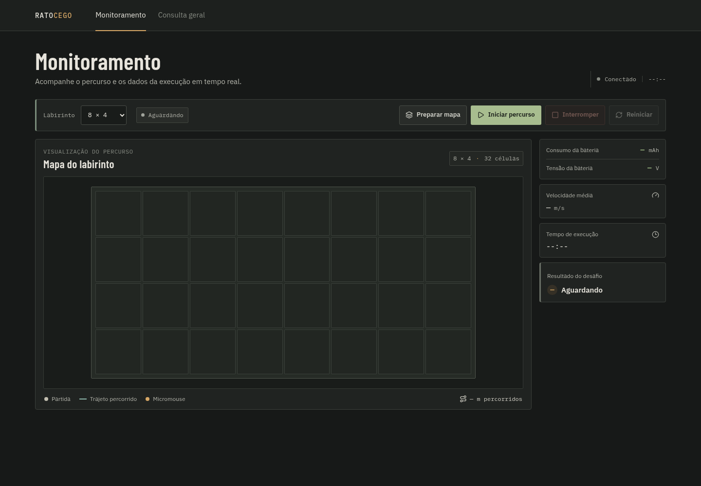
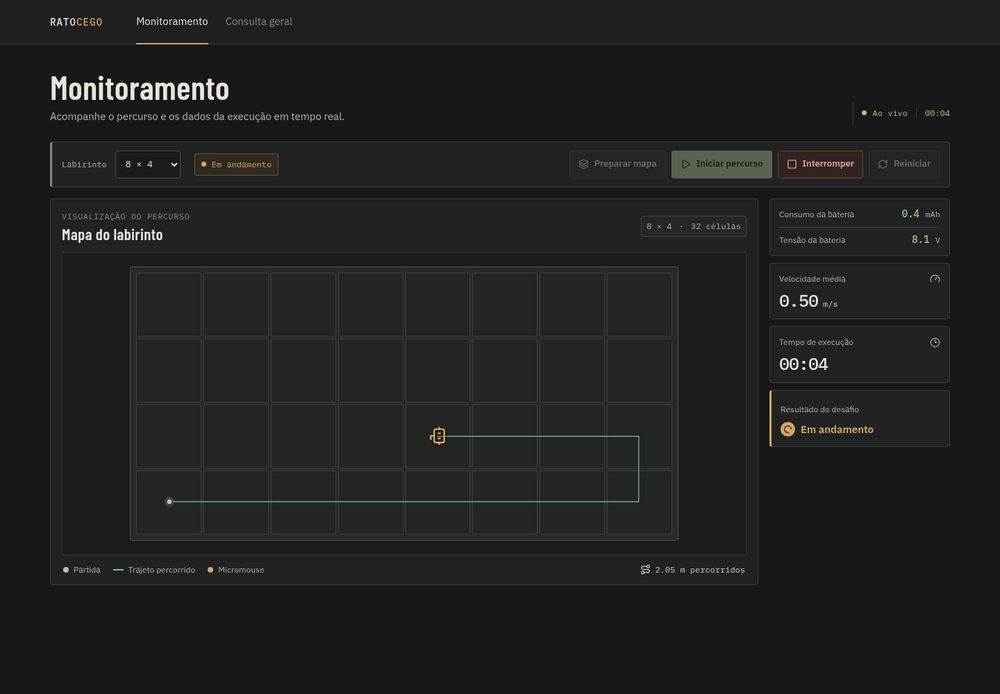
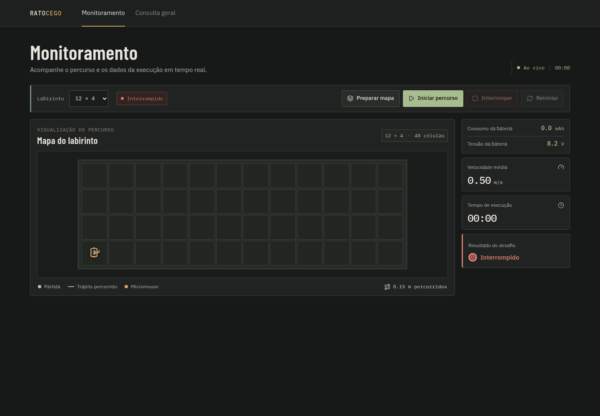
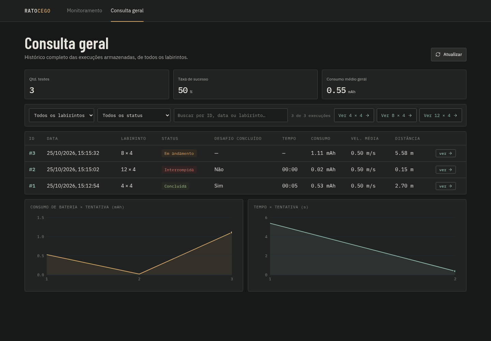
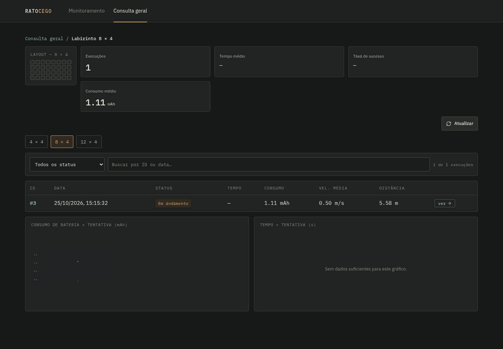
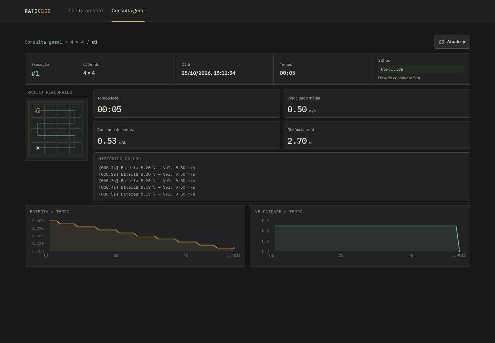
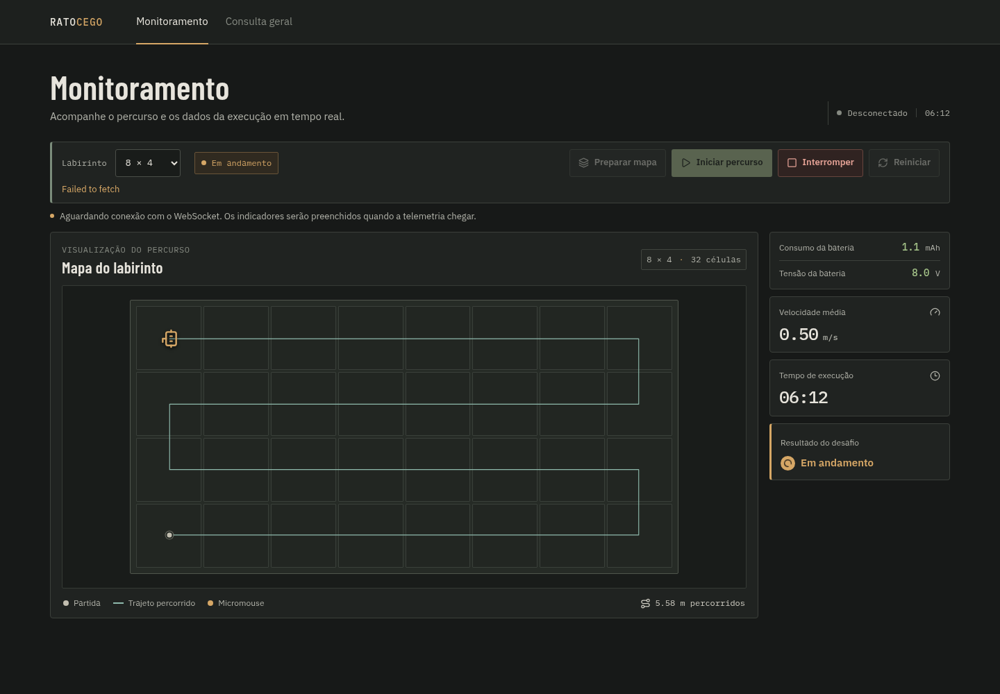
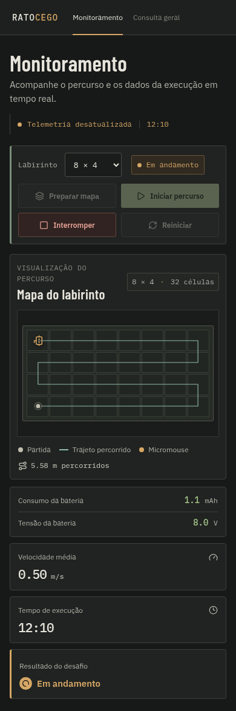

# Testes de Software

Os testes de software do Rato Cego verificaram o início e a interrupção de tentativas, o recebimento de telemetria e a consulta dos dados armazenados. A avaliação reuniu os testes automatizados do backend e a verificação funcional da aplicação web, por meio da navegação pelas telas e do uso de seus controles. Não foram desenvolvidos testes automatizados de frontend nem uma suíte E2E.

Os identificadores CT e HU relacionam os casos de teste às histórias de usuário do projeto. As funcionalidades avaliadas, os procedimentos e os resultados observados estão descritos nas seções a seguir.

## 1. Ambiente e condições de teste

As verificações registradas nesta seção foram realizadas em ambiente local, com PostgreSQL e Eclipse Mosquitto em contêineres Docker, gerenciados pelo Docker Compose. O backend e a interface web foram executados no mesmo computador. Para exercitar o monitoramento, foi utilizado um simulador em Python que representa a comunicação do robô com a aplicação por MQTT. Ele recebe os comandos de início e interrupção, percorre uma sequência predefinida de células e publica confirmações, posições e medições simuladas de bateria.

| Componente | Configuração utilizada |
|---|---|
| Interface web | React e TypeScript, servidos pelo Vite; navegação em Chromium. |
| Backend | Java 21, Spring Boot 4.1.1 e Maven Wrapper. |
| Comunicação | API REST, STOMP sobre WebSocket e broker Eclipse Mosquitto em contêiner Docker. |
| Armazenamento da aplicação | PostgreSQL em contêiner Docker. |
| Dados de percurso | Simulador em Python, com intervalo de publicação de 100 ms e velocidade configurada em 0,50 m/s. |
| Dimensões avaliadas | 4 × 4, 8 × 4 e 12 × 4, conforme as opções da interface. |
| Resoluções de tela | 1440 × 1000 pixels e 390 × 844 pixels. |

O trajeto e os valores apresentados nas imagens foram gerados pelo simulador. Eles permitem avaliar o funcionamento da aplicação, mas não medem a precisão dos sensores, o consumo real da bateria ou a capacidade de navegação do Micromouse. A designação 8 × 4 corresponde a quatro linhas e oito colunas; a opção 12 × 4 segue o mesmo padrão.

## 2. Funcionalidades avaliadas

A Tabela 1 relaciona os cenários executados às histórias de usuário. Quando um caso envolve mais de um subsistema, o resultado se refere à parte efetivamente verificada. Por exemplo, solicitar uma interrupção e receber sua confirmação na interface não comprova a parada física dos motores.

*Tabela 1 – Relação entre funcionalidades, histórias de usuário e verificações realizadas.*

| Caso do roteiro | Histórias de usuário | Verificação realizada | Resultado observado |
|---|---|---|---|
| CT-04 – Seleção e início | HU26, HU28 | Escolher o labirinto, preparar a grade e iniciar uma tentativa. | A grade acompanhou a seleção; o início confirmado habilitou a interrupção e bloqueou a troca de labirinto e um novo início. |
| CT-05 – Interrupção | HU29 | Solicitar a interrupção de uma tentativa 12 × 4. | A interface indicou a interrupção, e a API conservou os dados parciais com estado `INTERRUPTED`. A parada dos motores não foi avaliada. |
| CT-06 – Estados da execução | HU31, HU32 | Acompanhar início, andamento e término nos labirintos 4 × 4 e 8 × 4. | As tentativas apresentaram os estados de início, andamento e conclusão esperados na verificação realizada pela equipe. |
| CT-07 – Telemetria | HU35, HU45, HU47 | Acompanhar mensagens simuladas e executar os testes de validação do backend. | Posição e medições foram apresentadas no monitor; os cenários automatizados de validação e processamento passaram. |
| CT-08 – Dados da execução | HU36–HU40 | Observar trajeto, tensão, consumo, velocidade média, tempo e resultado. | Os indicadores foram atualizados durante o percurso. |
| CT-09 – WebSocket | HU41–HU44 | Colocar o navegador de teste em modo offline e restabelecer a conexão. | A tela informou a desconexão e voltou a reconhecer a conexão após a rede ser restabelecida. |
| CT-11 – Responsividade | RNF40, RNF42 | Abrir o monitor em largura de computador e de celular. | Os controles e indicadores foram reorganizados. A verificação ficou restrita ao monitor nessas duas resoluções. |
| CT-12 – Armazenamento | HU48, HU49 | Consultar as tentativas e suas dimensões após o uso do monitor. | Os registros foram recuperados com suas dimensões, estados e métricas, incluindo os dados parciais das tentativas interrompidas. |
| CT-13 – Histórico | HU50, HU51 | Acessar a consulta geral, a consulta 8 × 4 e o detalhe de uma tentativa 4 × 4. | As páginas apresentaram os registros correspondentes, o trajeto, as métricas e os gráficos disponíveis. |

Fonte: Elaborado pelos autores (2026).

## 3. Testes automatizados do backend

Os testes do backend foram executados com JUnit e Mockito, utilizando o suporte de testes do Spring. A suíte reúne verificações isoladas de regras e testes de integração entre componentes do backend.

Os testes de `RunLifecycleService` exercitam as solicitações de início e interrupção, os prazos de confirmação e as transições entre estados. Os de `TelemetryService` verificam a aceitação de amostras, a rejeição de dados inválidos, a identificação de duplicatas, os cálculos de consumo e a classificação da bateria. As consultas e os mapeadores são verificados quanto à seleção de registros e à preparação das respostas REST.

### 3.1. Integrações verificadas

A camada HTTP é exercitada por `RunControllerTest`, com `MockMvc` e `@WebMvcTest`. As requisições passam pelo controller e pelos mecanismos de validação e serialização do Spring; os serviços e o mapeador são substituídos por mocks. São avaliados o início de uma tentativa, os conflitos de estado, a ausência de registros, os filtros por labirinto e a consulta de telemetria.

O teste `MqttTelemetryWebSocketFlowTest` percorre o caminho entre o listener MQTT, o serviço de telemetria, o evento da aplicação e o adaptador WebSocket. Nesse cenário, os repositórios, o parser, o mapeador e o envio STOMP são simulados. A verificação confirma que os valores recebidos chegam à publicação de telemetria, incluindo potência e velocidade média calculadas.

Já `WebSocketUpdateTransactionTest` utiliza um contexto Spring e um banco H2 em memória para verificar o comportamento transacional. A atualização é publicada após o commit; quando a transação sofre rollback, a publicação não ocorre. O teste verifica a integração com o gerenciador de transações, sem testar o mapeamento JPA no PostgreSQL.

Esses cenários não abrem uma conexão real com o Mosquitto nem com um navegador. O uso dos serviços locais com a interface e o simulador é apresentado separadamente nas verificações funcionais da seção 4.

O limite de dez minutos também é verificado em `RunLifecycleServiceTest`, com relógio controlado: antes do limite não há interrupção; ao atingir ou ultrapassar o prazo, o backend solicita a parada. Os testes verificam ainda a espera pela confirmação, a preservação dos dados parciais e a ausência de reenvios automáticos a cada verificação.

### 3.2. Resultado da execução

A execução de `./mvnw verify` terminou com **BUILD SUCCESS**. Foram executados **88 testes em 21 classes**, sem falhas, erros ou testes ignorados.

*Tabela 2 – Distribuição dos testes automatizados do backend.*

| Grupo | Classes de teste | Testes executados |
|---|---:|---:|
| Ciclo de execução, telemetria e consultas | 3 | 37 |
| Controller REST | 1 | 14 |
| Adaptadores MQTT e fluxo MQTT–WebSocket | 4 | 9 |
| WebSocket, heartbeat e transações | 5 | 9 |
| Validação dos contratos MQTT | 2 | 5 |
| Mapeadores | 2 | 5 |
| Modelos e estados | 2 | 4 |
| Configuração MQTT e parser | 2 | 5 |
| **Total** | **21** | **88** |

Fonte: Relatórios Maven Surefire do projeto.

A cobertura foi medida pelo JaCoCo. A Tabela 3 apresenta os valores do conjunto do backend, incluindo as classes de configuração e os adaptadores.

*Tabela 3 – Cobertura de código do backend.*

| Medida | Elementos cobertos | Total | Cobertura |
|---|---:|---:|---:|
| Linhas | 514 | 610 | **84,26%** |
| Instruções | 2.561 | 2.979 | 85,97% |
| Desvios condicionais | 124 | 175 | 70,86% |
| Métodos | 130 | 145 | 89,66% |
| Classes | 45 | 49 | 91,84% |

Fonte: Relatório JaCoCo do projeto.

O resultado atende ao mínimo de 80% de cobertura de linhas configurado no projeto. `RunStatus` atingiu 100% das 22 linhas e dos 12 desvios condicionais contabilizados, atendendo também às metas específicas dessa classe. A cobertura global de desvios foi de 70,86%; o projeto não estabelece um mínimo global para essa medida.



*Figura 1 – Relatório de cobertura do backend após a execução dos testes.*

Fonte: Captura do relatório JaCoCo do projeto (2026).

As Tabelas 2 e 3 apresentam os resultados consolidados da execução e da cobertura. A suíte é executada pelo Maven com o comando:

```bash
cd src/backend
./mvnw verify
```

## 4. Verificação funcional da interface

A interface foi avaliada pelo uso dos controles e pela comparação entre o que aparece no monitor e o que é recuperado nas consultas. As capturas a seguir registram os estados observados durante essa verificação. Não foi criada uma suíte de testes de componentes ou de navegação automatizada para o frontend.

### 4.1. Seleção do labirinto e acompanhamento do percurso

Inicialmente, o monitor apresentou o estado de espera, a seleção do labirinto e os indicadores sem medições. O botão de interrupção permaneceu desabilitado enquanto não havia tentativa em andamento. O histórico também apresentou a mensagem de ausência de execuções.



*Figura 2 – Estado inicial do monitoramento.*

Fonte: Captura da aplicação Rato Cego (2026).

Após selecionar o labirinto e iniciar o percurso, o simulador confirmou a execução e passou a publicar telemetria. A interface desenhou o trajeto e atualizou distância, tensão da bateria, carga consumida, velocidade média e tempo. Durante a execução, a seleção de labirinto e os botões de preparação e início ficaram bloqueados; a interrupção ficou disponível.



*Figura 3 – Monitoramento de uma tentativa 8 × 4 com telemetria simulada.*

Fonte: Captura da aplicação Rato Cego (2026).

A tentativa 4 × 4, identificada como **#1**, foi concluída e recuperada no histórico com `COMPLETED`, distância de 2,70 m e velocidade média de 0,50 m/s. A API retornou duração de 5,401 s e consumo de 0,53 mAh. Esses valores são resultados do percurso simulado, não medições do robô. No teste funcional realizado pela equipe, o percurso 8 × 4 também apresentou o resultado de conclusão esperado no monitor e nas consultas.

### 4.2. Interrupção de uma tentativa

Para verificar a interrupção, foi iniciada uma tentativa 12 × 4, identificada como **#2**, e acionado o botão **Interromper**. O simulador publicou a confirmação, e a interface passou ao estado de interrupção. A consulta posterior retornou `INTERRUPTED`, `challengeCompleted=false` e os dados parciais do percurso, incluindo 0,15 m de distância e 0,02 mAh de carga consumida.



*Figura 4 – Interrupção confirmada com preservação dos dados parciais.*

Fonte: Captura da aplicação Rato Cego (2026).

A confirmação observada valida o tratamento do evento pela aplicação. O acionamento e a parada dos motores serão verificados com o robô assim que o desenvolvimento do firmware for concluído.

Para realizar uma nova tentativa após a interrupção, o operador utiliza **Iniciar percurso**, sem um controle separado de reinício.

O backend também solicita a interrupção automaticamente quando a execução atinge dez minutos, contados a partir da confirmação de início. O comando segue o mesmo fluxo MQTT da interrupção manual; a execução permanece em `INTERRUPT_REQUESTED` até a confirmação `run.interrupted`, preservando os dados parciais.

### 4.3. Consulta geral, consulta por labirinto e detalhe

A consulta geral apresentou as tentativas com suas dimensões, estados e métricas. O botão **Atualizar** foi utilizado para consultar novamente os registros. A tabela permitiu distinguir as tentativas em andamento, concluídas e interrompidas.



*Figura 5 – Consulta geral das tentativas de teste.*

Fonte: Captura da aplicação Rato Cego (2026).

Pelo acesso **Ver 8 × 4**, foi aberta a consulta específica desse tipo de labirinto. A página apresentou somente a tentativa **#3**, correspondente às dimensões selecionadas.



*Figura 6 – Consulta das tentativas de um tipo de labirinto.*

Fonte: Captura da aplicação Rato Cego (2026).

No detalhe da tentativa **#1**, foram recuperados o trajeto completo, a duração, a velocidade média, o consumo de bateria e a distância. A página também apresentou o histórico das amostras e os gráficos de tensão e velocidade em função do tempo, permitindo comparar o resumo com os dados do percurso.



*Figura 7 – Dados armazenados da tentativa #1.*

Fonte: Captura da aplicação Rato Cego (2026).

### 4.4. Perda e restabelecimento da conexão

A conexão foi interrompida somente no navegador de teste, por meio do modo offline. A tela passou a indicar **Desconectado**, apresentou o aviso de espera pelo WebSocket e conservou os últimos valores recebidos. Também foi exibida a mensagem `Failed to fetch`, referente à tentativa de consulta REST sem rede.



*Figura 8 – Indicação de indisponibilidade da comunicação no navegador.*

Fonte: Captura da aplicação Rato Cego (2026).

Após desativar o modo offline, foi verificado o restabelecimento da conexão sem recarregar a página. A indicação passou a **Telemetria desatualizada**, distinguindo a ausência de novas amostras da desconexão. A mensagem `Failed to fetch` permaneceu visível mesmo após a recuperação da conexão, indicando uma pendência no tratamento desse aviso. Como o simulador já havia sido encerrado, essa etapa avaliou a recuperação do WebSocket, sem uma nova sequência de telemetria. A interrupção e a reconexão do cliente MQTT ao broker não foram exercitadas nessa sessão.

### 4.5. Adaptação do monitor à largura de celular

O monitor foi aberto com área de visualização de 390 × 844 pixels. A disposição dos controles, da grade e dos indicadores foi conferida nessa largura, em comparação com a apresentação de 1440 × 1000 pixels. A largura da página medida no navegador foi de 390 pixels, igual à área de visualização, sem transbordamento horizontal nesse cenário. A Figura 9 registra a página completa na resolução menor. Essa verificação não abrange todos os navegadores, aparelhos ou páginas de consulta.

<p align="center">
  
</p>

*Figura 9 – Apresentação do monitor em largura de celular.*

Fonte: Captura da aplicação Rato Cego (2026).

## 5. Conclusão

Os testes automatizados do backend terminaram com 88 testes aprovados e cobertura de 84,26% das linhas, atendendo ao mínimo de 80% configurado no projeto. Foram verificadas as regras do ciclo de execução, o processamento da telemetria, as consultas e as integrações entre componentes do backend, incluindo a solicitação de interrupção ao atingir dez minutos.

A avaliação funcional realizada pela equipe confirmou o acompanhamento do trajeto e dos indicadores, a interrupção das tentativas e a consulta dos dados armazenados. Os fluxos de monitoramento e histórico apresentaram os resultados esperados nos cenários verificados.

A validação do ciclo completo com o robô físico será realizada assim que o desenvolvimento do firmware for concluído, utilizando os mesmos fluxos de início, monitoramento e interrupção exercitados com o simulador.
